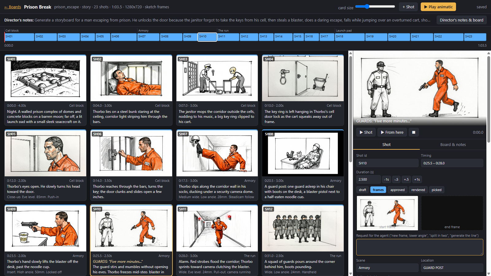

# comfy-ui-agentic-storyboard

A visual storyboard for AI video, built to be worked on by a person and an AI agent together, with frames
generated by your local [ComfyUI](https://github.com/comfyanonymous/ComfyUI).



- **Board**: one card per shot with its start/end frame, dialogue or lyric, camera and timing. Drag to reorder,
  resize by beats or seconds, split, duplicate, edit prompts, drop images or audio onto a shot.
- **Timeline and animatic**: shots play back to back with the board's song or voice-over, or each shot's own audio.
- **Director's notes**: write what the piece is; the agent turns it into shots and revises them on request.
  Every shot has a "Request for the agent" box ("new frame, lower angle", "split in two").
- **Frames through ComfyUI**: rough pencil sketches for planning, photo frames for shots headed to video
  (local MOSS-Image and Qwen-Image or paid GPT image, any text-to-image workflow works).
- **Hand-off**: approved shots export as folders (`start.png`, `end.png`, `prompt.txt`, `audio.wav`, `shot.json`)
  for whatever video workflow you render with.
- Stdlib Python only, one HTML page, files on disk. Every save keeps a history copy.

The exported shot folders fit the workflows in
[comfy-ui-video-workflows](https://github.com/idnn-productions/comfy-ui-video-workflows)
(dialogue with lip sync, singing, dance, motion, relighting, voice).

## Install

```bash
git clone https://github.com/idnn-productions/comfy-ui-agentic-storyboard
cd comfy-ui-agentic-storyboard
pip install -e .          # or run it in place with: python -m storyboard ...
```

Python 3.10+. `ffmpeg` on PATH is needed only for exporting audio. ComfyUI is needed only for `frames`.

## Use

```bash
export STORYBOARD_ROOT=/path/to/ComfyUI     # base for file paths stored in boards (default: current folder)
storyboard serve                             # opens http://127.0.0.1:8770/
```

On Windows, `storyboard.cmd` does the same (`set STORYBOARD_ROOT=...` first).

Create a board on the home page: give it a name, write the director's notes, tick "ask the agent to draft".
Then let your agent work the requests (see below), or add shots by hand with **+ Shot**.

```bash
storyboard requests                          # what the board is asking for
storyboard list prison_escape                # the shots as a table
storyboard frames prison_escape --missing    # sketch frames for shots without one (ComfyUI must be running)
storyboard export prison_escape --approved   # shot folders for rendering
```

Options and environment variables:

| option | env | default |
|---|---|---|
| `--root` | `STORYBOARD_ROOT` | current folder; file paths in boards are relative to it |
| `--boards` | `STORYBOARD_BOARDS` | `<root>/storyboards` (must be inside the root) |
| `--comfy` | `COMFY_URL` | `http://127.0.0.1:8188` |

Pointing the root at the folder that holds ComfyUI's `input/` and `output/` lets boards reference renders and
inputs directly, and lets the board play finished takes.

## Buttons that run things

Under a shot's frame slots, **Generate frame** makes its start frame through ComfyUI (sketch or photo, the board's
setting), and the board panel has **Generate missing frames now**. **Render shot** hands an approved shot with a
`workflow` to your renderer: set the command with `STORYBOARD_RENDER_CMD` (or `storyboard serve --render-cmd`), with the
placeholders `{board}`, `{shots}` and `{seeds}`, for example

```
STORYBOARD_RENDER_CMD="python /path/to/render_shots.py {board} --shots {shots} --seeds {seeds}"
```

Without it the button stays disabled. Jobs run one at a time on the server, the page shows their progress, and the
board reloads with the new frame or take when a job finishes. The command only ever receives validated board names,
shot ids and seeds.

## Working with an agent

The board and the agent share one file per board, `<boards>/<name>/storyboard.json`. You edit on the page; the agent
edits the JSON from a terminal; the page reloads when the file changes, and a save based on an older version is
refused instead of overwriting the other side's edit.

[AGENTS.md](AGENTS.md) is the agent's guide: the request loop, the board format, how to draft shots from a brief,
frames and hand-off. With Claude Code, start it in this folder (or point it at AGENTS.md) and say
"work the storyboard requests".

There is no built-in LLM call: the board leaves requests, your agent of choice handles them.

## Frames

```bash
storyboard frames <board> [--shots SH01,SH02] [--style sketch|photo] [--missing] [--count N] [--seed N] [--model ID]
```

`--count` makes up to 10 takes per shot, each with its own seed; every take is kept as a version of the shot's start
frame (the strip of thumbnails in the shot panel, newest first: click one to use it). For a model that is not built in,
export a text-to-image workflow from ComfyUI with **Export (API)**, put `{{prompt}}`, `{{seed}}`, `{{width}}`,
`{{height}}` in its widget values, and pass `--workflow that.json`.

### Frame models per shot
Each shot can pick the model that makes its frame (**Frame model** in the shot panel), and the board sets the default
(**Frame model (default)** in the board panel). The models form a ladder from cheap to expensive, and the **&uarr;**
button next to the menu moves a shot one step up: first passes on the local MOSS and Qwen models (queue ten takes to
find the feel), then GPT flare for the shots the local frames don't get right, then sunburst if flare doesn't either.

| id (ladder order) | model | where | file(s) checked |
|---|---|---|---|
| `moss-dmd` (default) | MOSS-Image SFT with the 8-step DMD distillation merged into int8 ([Spectrallic/MOSS-Image-SFT-8step-DMD-int8-convrot](https://huggingface.co/Spectrallic/MOSS-Image-SFT-8step-DMD-int8-convrot)), 8 steps, ~3 s | local, ComfyUI (v0.42.0+) | `moss_image_sft_8stepdmd_int8_convrot`, `qwen3.5_9b_w4a8_gptq`, `flux2-vae_small` |
| `moss` | MOSS-Image, 25 steps, ~15 s (best local lettering) | local, ComfyUI | `moss_image_sft_int8_convrot` + the same text encoder and VAE |
| `qwen21` | Qwen-Image 2.1, 25 steps, ~10 s | local, ComfyUI | `qwen_image_2.1_int8_convrot`, `qwen3vl_8b_int8_convrot`, `qwen_image_2.1_vae_bf16` |
| `gpt-flare`, then `gpt-sunburst` | GPT image 2.6 | OpenAI API, paid (~$0.04-0.06 a frame) | `OPENAI_API_KEY` set |

Z-Image Turbo was removed (its frames were not usable); boards that still name `zimage` use the board default.

### Annotate and revise
Click the frame in the preview (or **&#9998; Annotate**) to open it full size. Drag a box around what should change, or
draw with the pen; each mark gets a number and its own note, and an overall note covers the rest ("lower camera
angle"). Pick the model and the number of takes and press **Send for revision**. Every result is a new version of the
start frame, with the parent frame, the notes, the model and the cost in its `.json`.

- **Qwen-Image 2.1 and GPT** are edit models: they get the frame, a copy with the numbered marks drawn on it, and an
  instruction built from the notes ("1. In the top left of the image (mark 1): ..."); GPT also gets a mask.
- **MOSS** repaints only the marked areas of the frame (img2img with a latent noise mask, strength 0.9 by default).
  It does not see the frame's old prompt, so describe what should be there ("a black handheld microphone in her right
  hand") rather than giving an instruction.
- With marks, **keep everything outside the marks pixel-identical** (on by default) pastes the result back onto the
  original through a soft-edged mask in ComfyUI.

The page uploads the annotated copy and the mask to the board's `revisions/` folder; the server checks the request and
writes it to a file there, and the job reads that file (`storyboard revise <board> <shot> --request ...`), so note text
never reaches a command line.

Before anything runs, the server checks that each model can run now: a local model needs ComfyUI up and every file its
graph loads (asked through ComfyUI's `/object_info`), a cloud model needs its key in the environment (the key is never
written into a board or a file). Models that can't run are greyed out in the menus with the reason, and a frames job
that needs one is refused. Paid frames show the estimated cost on the button and need a second click; the measured
cost goes into the frame's `.json`. `storyboard models` prints the same check, and `storyboard frames --model ID`
overrides every shot. Add your own models in a JSON file named by `STORYBOARD_MODELS`
(`{"id": {"label": ..., "kind": "local", "graph": "my_graph.api.json"}}`, graph path relative to that file).

Prompts come from the shot's action, framing (shot size and angle) and character descriptions. Names and lens or
camera-move words are left out on purpose: image models tend to letter them into the picture. A shot's
`start_frame_prompt` overrides the generated prompt.

## Security

The server binds to 127.0.0.1, answers only requests addressed to `127.0.0.1`/`localhost`, requires a custom header
on every write (so other web pages cannot post to it), serves files only from the root, and writes uploads only into
the board's own folder. It has no authentication: do not expose it on a network.

## Tests

```bash
python -m unittest discover -s tests
```

## License

MIT

## Example

`examples/prison_escape/` is the board in the screenshot without its frames: 23 shots an agent drafted from a
one-paragraph brief. Copy the folder into your boards directory and run `storyboard frames prison_escape`.
